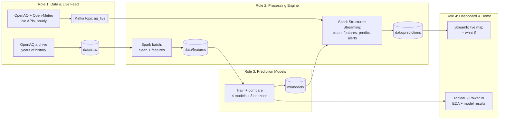

# AirGuard Delhi-NCR

Live air quality forecasting and station-level alerts for Delhi-NCR, built on **Kafka + Spark**.
CSET-371 Big Data Analytics and Business Intelligence, course project.

**In one line:** every hour the system pulls live pollution and weather readings for every Delhi monitoring station, streams them through Kafka into Spark, predicts PM2.5 **1, 3 and 6 hours ahead** for each station, and warns before a neighbourhood turns Very Poor or Severe.

---

## How it fits together



- **Batch path (training):** years of station history → cleaned and turned into features in Spark → models trained and compared → best models saved.
- **Live path (every hour):** live API → Kafka → Spark Structured Streaming → same features → saved model predicts → alerts → dashboard.

---

## Team

| Role | Person | Folder | Owns |
|---|---|---|---|
| 1. Data & Live Feed | Riya Maurya | [`ingestion/`](ingestion/README.md) | Historical data, live fetcher, Kafka feed, replay mode, EDA charts |
| 2. Processing Engine | Ansh Singh | [`pipeline/`](pipeline/README.md) | Cleaning, features, Spark streaming job, alerts, integration |
| 3. Prediction Models | Ayush Mishra | [`ml/`](ml/README.md) | Baseline, 4 models × 3 horizons, classifiers, results, what-if `score()` |
| 4. Dashboard & Demo | Riya Katiyar | [`dashboard/`](dashboard/README.md) | Streamlit live map + what-if, BI dashboard, demo script, README, screenshots |

**Ansh's laptop is the demo machine.** Everything runs together on it from Day 8.

Start with your folder's README: it has your steps, your handoff dates, what "done" means, and a ready-to-paste AI prompt.

---

## Key files

| File | What it is |
|---|---|
| [`CONTRACT.md`](CONTRACT.md) | **The shared formats.** Every message, file and column the four parts exchange. Read this first. |
| [`docs/TIMELINE.md`](docs/TIMELINE.md) | 12-day sprint, day by day, with handoffs |
| [`docs/RUBRIC_CHECKLIST.md`](docs/RUBRIC_CHECKLIST.md) | Every rubric requirement → where the evidence comes from → who owns it |
| [`CLAUDE.md`](CLAUDE.md) | Rules your AI coding tool follows automatically in this repo |
| `common/` | Shared code: paths, AQI categories, Spark session, schemas. Import it, don't copy it. |
| `infra/docker-compose.yml` | Kafka, one command |
| `scripts/check_setup.py` | Tells you exactly what is missing on your laptop |

---

## Setup (Day 1, everyone)

You need: **Git, Docker Desktop, Java 17, Python 3.10+**. Windows laptops run everything inside **WSL (Ubuntu)** because Spark on plain Windows needs extra hacks that waste days.

### Windows (Ansh, Riya Maurya, Ayush)

1. **Install WSL.** Open PowerShell as Administrator:
   ```powershell
   wsl --install -d Ubuntu
   ```
   Restart, open "Ubuntu" from the Start menu, and create a username and password.
2. **Install Docker Desktop** for Windows. In Docker Desktop: Settings → Resources → WSL integration → turn on **Ubuntu**.
3. **In the Ubuntu window**, install the tools:
   ```bash
   sudo apt update && sudo apt install -y openjdk-17-jdk python3-venv python3-pip git
   ```
4. **Clone into your Linux home folder** (not `/mnt/c/...`, which is very slow):
   ```bash
   cd ~ && git clone https://github.com/anshace07/airguard-delhi.git && cd airguard-delhi
   ```
5. Continue with **"Both"** below.
6. For coding, install VS Code on Windows plus its **WSL** extension, then type `code .` inside the Ubuntu window.

### Mac (Riya Katiyar)

1. Install [Homebrew](https://brew.sh), then:
   ```bash
   brew install openjdk@17 python@3.12 git
   sudo ln -sfn "$(brew --prefix)/opt/openjdk@17/libexec/openjdk.jdk" /Library/Java/JavaVirtualMachines/openjdk-17.jdk
   echo 'export JAVA_HOME=$(/usr/libexec/java_home -v 17)' >> ~/.zshrc && source ~/.zshrc
   ```
2. Install **Docker Desktop for Mac** (pick Apple Silicon or Intel to match your Mac).
3. Clone:
   ```bash
   cd ~ && git clone https://github.com/anshace07/airguard-delhi.git && cd airguard-delhi
   ```
4. Continue with **"Both"** below.

### Both

```bash
python3 -m venv .venv
source .venv/bin/activate          # run this every time you open a new terminal
pip install -r requirements.txt
cp .env.example .env               # Role 1 and the demo laptop: paste the OpenAQ key into .env
python scripts/check_setup.py      # every line should say OK
```

Then start Kafka and check it:

```bash
docker compose -f infra/docker-compose.yml up -d
python scripts/check_setup.py --kafka
```

Stuck for more than 30 minutes on setup? Post the exact error in the group. Ansh fixes setup problems on Day 1.

---

## Running things

Always run from the repo root, with the virtual environment active. Run Python modules with `-m` so they can import `common/`.

| What | Command | Owner |
|---|---|---|
| Kafka on / off | `docker compose -f infra/docker-compose.yml up -d` / `down` | everyone |
| Peek at live messages | `docker exec -it airguard-kafka /opt/kafka/bin/kafka-console-consumer.sh --bootstrap-server localhost:9092 --topic aq_live --from-beginning` | everyone |
| Tests | `python -m pytest -q` | everyone |
| Live fetcher | `python -m ingestion.fetch_live` | Role 1 (to be built) |
| Replay a past day | `python -m ingestion.fetch_live --replay 2025-11-05` | Role 1 (to be built) |
| Clean history | `python -m pipeline.clean_history` | Role 2 (to be built) |
| Streaming job | `python -m pipeline.stream_job` | Role 2 (to be built) |
| Train models | `python -m ml.train` | Role 3 (to be built) |
| Dashboard | `streamlit run dashboard/app.py` | Role 4 (to be built) |

Update this table when your part is built.

---

## Git rules (read once, follow always)

1. **Work on your own branch:** `riya-m/ingestion`, `ansh/pipeline`, `ayush/ml`, `riya-k/dashboard`.
   ```bash
   git checkout -b ansh/pipeline     # first time only
   ```
2. **Every morning, pull the latest `main` into your branch:**
   ```bash
   git checkout main && git pull && git checkout <your-branch> && git merge main
   ```
3. **Commit and push at least once a day.** Then open a Pull Request into `main`. Ansh merges.
4. **Stay in your own folder.** Changing `CONTRACT.md` or `common/` needs the whole team to agree first (CONTRACT.md section 9).
5. **Never commit** `data/`, `.env`, or `ml/models/`. The `.gitignore` already blocks them; don't force it.

---

## Using AI

AI can write all of the code. Three rules:

1. Your AI tool reads [`CLAUDE.md`](CLAUDE.md) automatically. Start every new task with: *"Read CONTRACT.md and my folder's README first."*
2. **You must be able to explain every line of your own module** in the viva. Ask the AI to explain anything you don't understand, then explain it back to the team in the weekly walkthrough.
3. **The report is written by hand.** The rubric requires 0% AI-detected text. Use AI to understand things, never to write report paragraphs.

---

## Data sources

| Source | Used for | Notes |
|---|---|---|
| [OpenAQ archive on AWS](https://registry.opendata.aws/openaq/) | Historical hourly readings (training) | Free, no AWS account needed |
| [OpenAQ API v3](https://docs.openaq.org) | Live hourly readings | Free key; rate limited |
| [Open-Meteo](https://open-meteo.com) | Live and historical weather | Free for non-commercial use; check their terms |
| data.gov.in (CPCB) | Optional second live source | Free key |

Faculty approval of the dataset is required by the rubric. Confirm with ma'am before training on it.
